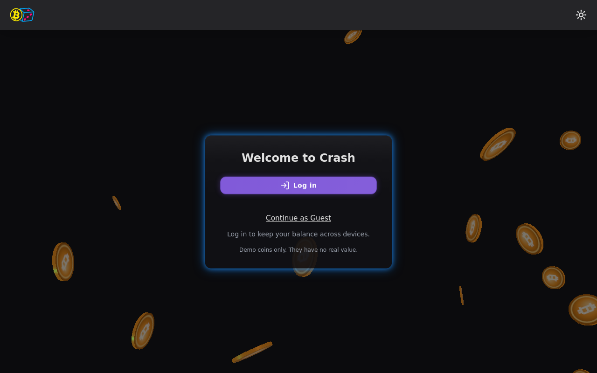
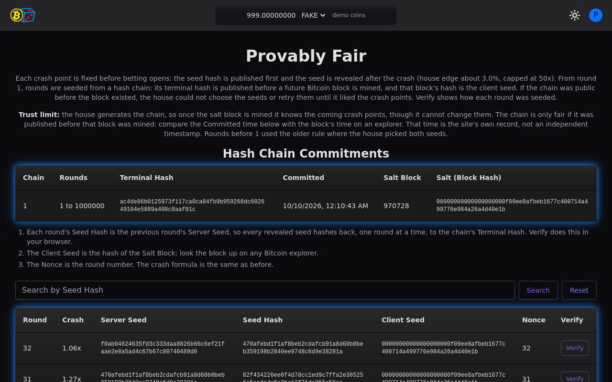
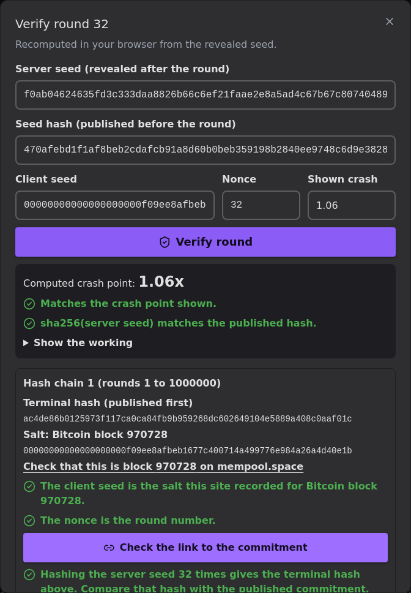
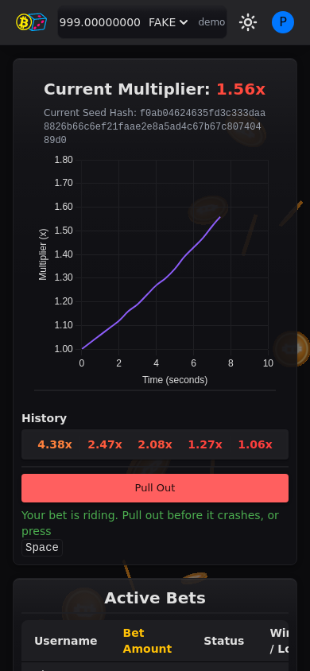

# Features

---

## Signing in

There are two ways in:

- **Continue as Guest.** One click creates a guest player with a generated name (for example `player-ab12cd34ef`) and 1,000 FAKE. There is no password.
- **Log in.** This opens the 4zam sign-in page, where you choose Google, Microsoft or GitHub. A 4zam account keeps your balance across devices.

Good to know:

- A guest session lasts 7 days and renews while you play.
- Logging out leaves the guest and its balance behind. There is no way back into it. A guest that stays idle for 7 days is removed.
- If you log in while playing as a guest, the guest becomes your 4zam account and keeps its balance. If that 4zam account has already played Crash, the guest balance is not merged into it.
- Passwords and two-factor sign-in are managed in your 4zam account, not in Crash.

---

## How a round works

1. **Betting opens for 15 seconds.** Enter an amount and press Place Bet. You can also set an auto cash-out multiplier (1.01x or higher).
2. **The round starts at 1.00x** and the multiplier climbs. It reaches 2x after about 12 seconds and 10x after about 38 seconds.
3. **Pull out before the crash.** Press Pull Out or the Space key. Your bet is paid at the multiplier when the server received your cash-out.
4. **The round crashes** at a point fixed before betting opened. Bets still riding lose.

Rules:

- One bet per round. The largest bet is 1,000,000.
- Pull Out during the betting window cancels the bet and refunds it.
- Auto cash-out is sent from your browser tab, so keep the tab open and in front.
- Crash points are capped at 50x. About 1 round in 33 crashes instantly at 1.00x, which gives the house an edge of about 3%.
- Rounds only run while someone is on the game page. When nobody is there, the game pauses and starts again with the next visitor. The chart shows "Rounds are paused" while it waits.

On the game page you also get:

- **Active Bets:** everyone's bet on the current round, its status and the result.
- **History:** the last 5 crash points, colored by how high each round went.
- **Game chat:** live chat for every player, guests included. Messages are up to 280 characters.

---

## Demo coins

Crash has two demo currencies. Neither has real value.

| Currency | What it is | Shown with |
|---|---|---|
| Fake Points (FAKE) | Play balance. Guests start with 1,000 FAKE. | 2 decimals |
| Bitcoin (BTC) | Demo Bitcoin on a private regtest network | 8 decimals |

- The header shows your balance with a "demo coins" label at all times.
- Pick the currency in the header dropdown. Your bets use that currency.
- Bets settle instantly on the site's own ledger. Only the faucet and withdrawals use the Bitcoin test network.

---

## Wallet

The Wallets page shows each balance and its transaction history.

- **Faucet.** Claim 0.5 demo BTC once every 24 hours. The faucet is off while you hold 5 demo BTC or more, and it has daily limits per IP address and for the whole site.
- **Withdrawals.** Send demo BTC to an address on the test network. A small network fee is added on top. A withdrawal confirms in about a minute and cannot be undone. There is a daily limit of 10 demo BTC.
- **Transactions.** Bets, payouts, faucet claims, deposits and withdrawals all appear in the history. Incoming transfers show while they confirm.

---

## Provably fair

Each crash point is fixed before betting opens. Crash uses a hash chain based on the Bustabit scheme:

- **The chain.** The house generates a chain of 1,000,000 seeds where each seed is the SHA-256 hash of the next one. It publishes the last hash (the terminal hash) first.
- **The salt.** At the same time it names a future Bitcoin block. Once that block is mined and has 6 confirmations, its hash becomes the client seed for every round in the chain. The house could not know that hash when it published the chain.
- **Each round.** The round's seed hash is shown before betting opens. After the crash, the seed is revealed. It hashes to the published seed hash, and that hash is the previous round's seed, all the way back to the terminal hash.
- **The crash point** comes from HMAC-SHA256 of the seed with the client seed and the round number (the nonce).

The Provably Fair page lists the published chain (terminal hash, commit time, salt block and its hash) and every round with its seeds. You can search by seed hash.

### Verify a round

Press **Verify** on any round in the Provably Fair page. The checks run in your browser:

- It recomputes the crash point and checks it matches the one shown.
- It checks that the revealed seed hashes to the seed hash published before the round.
- It shows the chain and the salt block, with a link to look the block up on mempool.space.
- **Check the link to the commitment** hashes the seed back to the chain's terminal hash.
- **Show the working** lists each step of the calculation.

!!! warning "Trust limit"
    The house generates the chain. Once the salt block is mined, it knows the coming crash points, though it cannot change them. The chain is only fair if it was published before that block was mined. The commit time shown is the site's own record, not an independent timestamp. Crash states this on the Provably Fair page.

---

## Bets

- **All Bets** lists every bet on the site: player, amount, multiplier, net winnings, time and seed hash. Search by username and sort by any column except seed hash.
- **My Bets** shows only your bets.
- The seed hash links to that round on the Provably Fair page, where you can verify it.

---

## Profile and settings

- **Profile:** your username and the color of your name in chat.
- **Settings:** dark mode on or off (dark is the default) and the animated background on or off.
- If your device asks for reduced motion, the animated background stays off.

---

## On phones

{ width="320" }

The game page stacks into one column on small screens. The chart, bet controls, active bets and chat all stay available.
