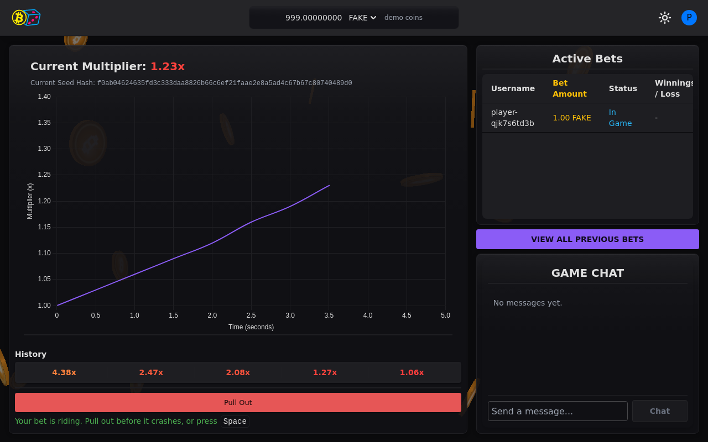

# Crash

Crash is a real-time multiplayer crash game played with demo coins. Every round is provably fair, and you can check any round in your browser.

Formerly BTCGambler.

[Play Crash](https://crash.4zam.dev)

!!! note "Demo coins only"
    Crash uses demo coins. They have no real value. There is no way to pay in money or cash out.

---

## Overview

- **Play in one click.** Continue as a guest, or log in with a 4zam account (Google, Microsoft or GitHub).
- **Live rounds.** A multiplier climbs from 1.00x until it crashes. Pull out before the crash to win.
- **Provably fair.** Each round is seeded from a published hash chain and a future Bitcoin block. A built-in verifier recomputes the crash point.
- **Two demo currencies.** Fake Points (FAKE) and demo Bitcoin (BTC) on a private test network.
- **Live chat** and a full bet history.

---

## Docs

- [Features](features.md): how the game, sign-in, fairness and wallet work
- [Architecture](architecture.md): the services behind the game
- [Setup](setup.md): running Crash locally
